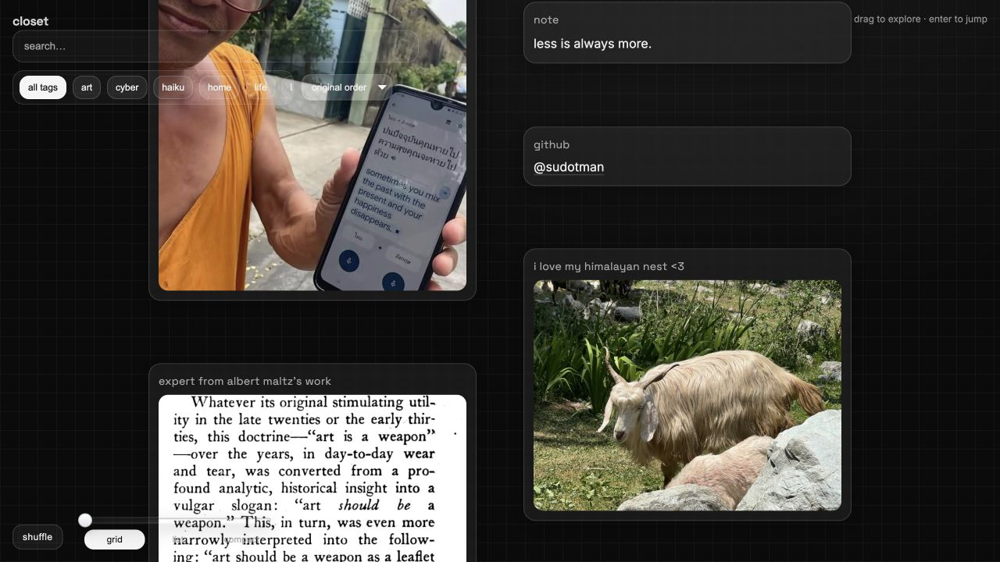

# closet

A drifting canvas of things. Static files, no build step, served by GitHub Pages.

**[Explore the closet](https://closet.satyam.lol/)** · **[Open the console](https://closet.satyam.lol/admin/)**



---

## Run it locally

```bash
python -m http.server 4000
```

Then open <http://localhost:4000>. The console lives at `/admin/`.

There is nothing to install and nothing to compile — every file in this repo is
served exactly as it sits on disk.

## Deploy

Push to `main`. Pages is enabled for the repository root, and the custom domain
comes from `CNAME`.

---

## The canvas

| | |
|---|---|
| drag | pan |
| scroll | pan · <kbd>⌘</kbd>/<kbd>ctrl</kbd>+scroll or pinch to zoom |
| arrows | step between entries |
| <kbd>⏎</kbd> | open the held entry |
| <kbd>⌘K</kbd>, or just start typing | search |
| <kbd>0</kbd> | frame everything |
| <kbd>+</kbd> <kbd>−</kbd> | zoom |
| <kbd>\\</kbd> | collapse the index drawer |
| <kbd>esc</kbd> | back out of anything |

Three ways to look at the same archive: **grid** (masonry), **list** (one wide
column), **index** (a dense catalogue of collapsed rows).

Filters are shareable. `?tag=cyber,useful`, `?view=list` and `?sort=title` are
read on load and kept in the URL as you change them; `#some-entry-id` centres
the canvas on one entry.

### Files

| file | what it is |
|---|---|
| `index.html` · `styles.css` · `script.js` | the canvas |
| `tokens.css` | design tokens — colour, type, motion. Shared. |
| `card.css` · `card.js` | the card itself, shared by the canvas and the console |
| `entries.json` | all the content |
| `uploads/` | images |
| `admin/` | the console |

`card.js` is the single renderer for an entry, which is why the console's
preview is the real card rather than an approximation of it.

---

## Content

`entries.json` holds one array under `root`. Each entry:

| field | notes |
|---|---|
| `type` | `image` · `text` · `link` · `text_link` · `youtube` |
| `id` | stable slug, used by `#deep-links`. Generated if absent. |
| `title` | the small label above the content |
| `tags` | array of lowercase strings |
| per type | image: `src`, `alt` · text: `text` · link: `url`, `linkText` · text_link: `text`, `url`, `linkText` · youtube: `youtubeId` |

Order in the file is the order on the canvas, and the index number printed on
each card.

**On `x` and `y`:** older entries carry them. They are inert — the layout engine
computes every position from the current viewport, so the canvas reflows
properly at any size. They are preserved when the console writes the file, and
can be deleted by hand whenever you like.

---

## The console

`/admin/` is a static page that talks to the GitHub API directly from your
browser. No server, no Netlify Identity, no OAuth proxy — the previous Decap
setup and its `admin/config.yml` are gone.

### Signing in

1. Create a [fine-grained token](https://github.com/settings/personal-access-tokens/new)
   scoped to **this repository only**.
2. Give it **Contents: Read and write**.
3. Add **Pull requests: Read and write** if you want to open PRs instead of
   committing straight to `main`.
4. Paste it into the console. It is kept in `localStorage` (or only for the tab,
   if you untick "keep me signed in") and sent nowhere but `api.github.com`.

A browser-held token is readable by anything that can run script on the page.
Scope it to one repository, and revoke it if you are ever unsure. A classic
token with the `repo` scope also works, but grants far more than this needs.

### What it does

- **Edit** every field, with the form shaped by the entry's type.
- **Preview** the real card, live, beside the form.
- **Reorder** by dragging a row's grip, or <kbd>alt</kbd> + <kbd>↑</kbd>/<kbd>↓</kbd>.
- **Tags** as chips, with every existing tag one click away.
- **Images**: drop one in. It is staged locally, shown in the preview
  immediately, and committed alongside `entries.json` when you publish — so a
  pull request never points at a file that isn't there yet.
- **YouTube**: paste any watch, share, shorts or embed URL; the id is extracted.
- **Review** a field-level diff of everything you changed before it leaves the
  browser.
- **Publish** as a direct commit, or as a new branch with a pull request opened
  against `main`.
- **Drafts** survive a refresh; unpublished work is kept in `localStorage`.
- **Offline**: skip the token entirely to edit the local `entries.json`, review
  the diff, and download or copy the result.

Before writing, the console re-reads `entries.json` and refuses to publish if
the blob changed since you loaded it, so two tabs cannot quietly overwrite each
other.

<kbd>⌘S</kbd> opens review · <kbd>⌘K</kbd> jumps to the filter.

### `tags/`

The `tags/*.json` files existed only to feed Decap's relation widget. The
console derives the tag list from `entries.json` itself, so they are no longer
read by anything. They are left in place rather than deleted for you — remove
the folder whenever you want.
